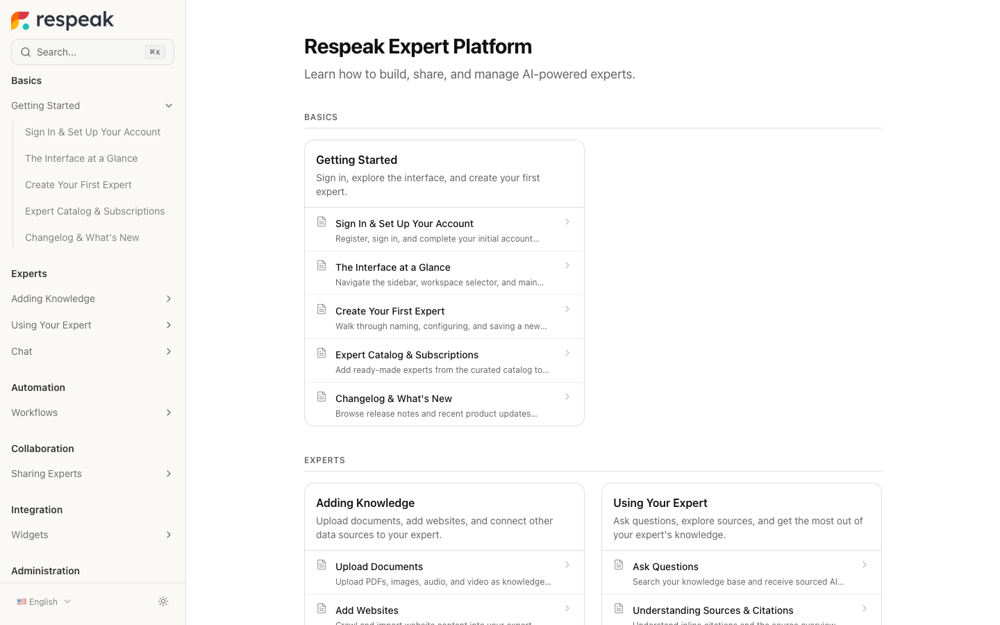
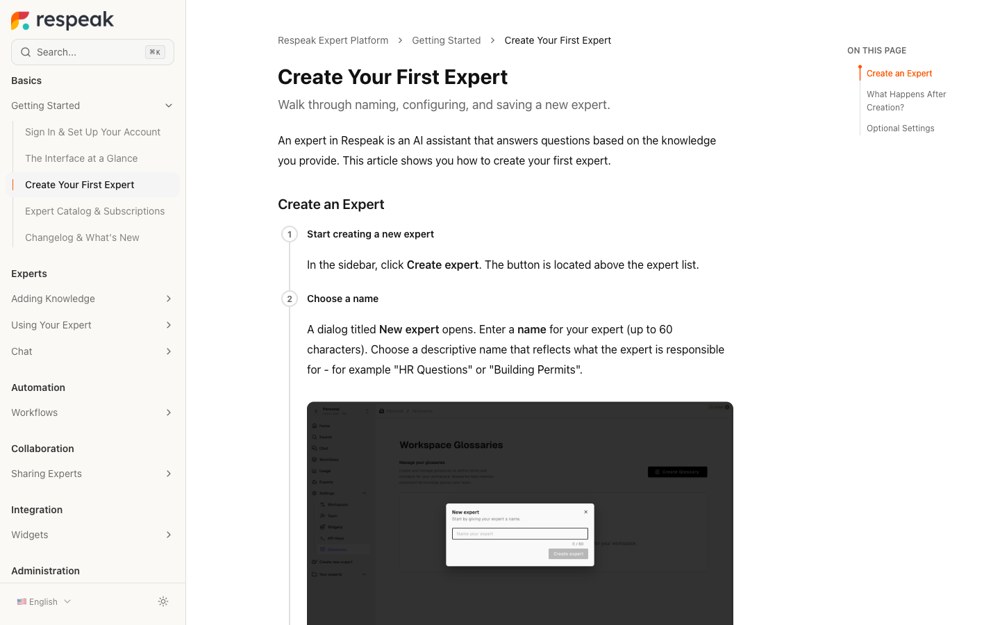

[](LICENSE)
[](https://www.npmjs.com/package/@respeak/recap)

# Recap

Turn your product into documentation. Point Recap at a **codebase** or a **video**, and it generates structured Markdown docs — then publishes them as a polished, multi-language docs site.

```bash
npx @respeak/recap generate --codebase . --app http://localhost:3000
```



*A docs site generated with Recap and published to [docs.respeak.io](https://docs.respeak.io/en/experte) — searchable, multi-language, three-column layout.*

## Generate docs from your codebase (AI-first)

Point Recap at your repo and your running app. It discovers the features, drives a real browser through each one, narrates the walkthrough, and produces **narrated videos + Markdown docs with screenshots** — no manual capture.

```bash
export GEMINI_API_KEY=your-key-from-https://ai.google.dev
npx @respeak/recap generate --codebase . --app http://localhost:3000
```

`generate` chains three steps you can also run on their own — handy for reviewing the plan before it records anything:

1. **`analyze`** — scans the codebase (Next.js-aware, with a generic fallback), asks Gemini to identify user-facing features, and writes an editable `plan.yaml`.
   ```bash
   npx @respeak/recap analyze --codebase . --app http://localhost:3000 --hints "focus on settings + billing"
   ```
   Open `plan.yaml`, fill in app auth (login credentials), tweak the feature list and narration, choose output languages and a TTS voice.

2. **`record`** — drives a real browser (Playwright) through every feature in the plan, capturing video and step-by-step screenshots.
   ```bash
   npx @respeak/recap record --plan plan.yaml
   ```

3. **`produce`** — generates TTS narration, merges audio + video with `ffmpeg`, translates into your configured languages, and writes Markdown docs with the captured screenshots.
   ```bash
   npx @respeak/recap produce --plan plan.yaml
   ```

Output lands in `./generated/videos` and `./generated/docs` by default. Requires a free [Gemini API key](https://ai.google.dev); `produce` also needs [`ffmpeg`](https://ffmpeg.org) installed.

## Or generate from a video

Some things only have a YouTube video for docs. Point Recap at a URL or a local file and get structured Markdown back:

```bash
npx @respeak/recap https://youtube.com/watch?v=your-video -o ./docs
```

```
Usage: recap [options] <source>

Arguments:
  source                 Video file path or URL

Options:
  -o, --output <dir>     Output directory (default: "./docs")
  -k, --api-key <key>    Gemini API key (or set GEMINI_API_KEY env var)
  -f, --format <format>  Output format: markdown, mdx (default: "markdown")
```

Use `--format mdx` for Docusaurus, Mintlify, or other MDX-based doc sites — it adds YAML frontmatter with `title` and `sidebar_position`.

## Publish as a docs site

Keep docs in your product repo as a `docs/` folder (Markdown + a `sync.json` manifest) and sync them to a Recap project — no copy-pasted scripts:

```bash
npx @respeak/recap diff ./docs --api-key rd_xxx   # preview changes, writes nothing
npx @respeak/recap push ./docs --api-key rd_xxx   # publish (declarative reconciliation)
```

Get an org API key (`rd_…`) from the Recap dashboard under **API Keys**, or set `RECAP_API_KEY`. Always `diff` before `push` — `push` is declarative, so anything not in `sync.json` is removed on the server. Syncs run manually with `npx` — pin an exact version (e.g. `@respeak/recap@0.4.0`) for reproducible runs. See [`docs/sync-client/`](docs/sync-client/README.md) for the manifest format and cross-link rewriting.



*What readers get: numbered steps, screenshots auto-captured from your app, an on-page table of contents, full-text search, and a language switcher.*

## Drive it from your repo with a coding agent

Recap is built to be run by a coding agent right inside your repo. Install the bundled skill and the agent picks up the workflow — the diff-before-push gate, the Markdown block syntax, and the cross-link rules:

```bash
npx @respeak/recap skill --update   # writes .claude/skills/recap/SKILL.md
npx @respeak/recap skill --check    # exit 1 if the local skill drifted from the installed CLI
```

The skill is generated from the installed CLI version (the single source of truth), so a version bump shows up as drift in `--check`. Paired with the `generate` pipeline above, an agent can author docs from your codebase and keep your live docs site in sync — without you copy-pasting commands.

## Example Output

Some things only have YouTube videos for docs. Recap fixes that:

- [AusweisApp & Online ID](gallery/ausweisapp-online-id/) — Germany's eID function, docs scattered across government PDFs
- [Elektronische Patientenakte](gallery/epa-patientenakte/) — Germany's digital health record, docs fragmented across dozens of sites
- [ELSTER Tax Filing](gallery/elster-tax-filing/) — Germany's tax portal, so confusing it spawned an entire paid-software industry
- [FFmpeg](gallery/ffmpeg/) — the most used multimedia tool in the world, famously impenetrable docs
- [Respeak Expert Platform](gallery/respeak-document-intelligence/) — our own platform, dogfooding Recap

<details>
<summary>More examples</summary>

- [Langdock Workflows](gallery/langdock-workflows/) — building AI agent workflows, from a product tour
- [n8n Workflow Automation](gallery/n8n-workflow-automation/) — from a 2-min tutorial
- [Supabase Overview](gallery/supabase-overview/) — from the official product tour

</details>

## Comparison

| | Recap | Scribe | Tango | Manual |
|---|---|---|---|---|
| Open source | Yes | No | No | N/A |
| From a codebase | Yes | No | No | No |
| From video | Yes | No (screenshots) | No (screenshots) | No |
| Self-hosted | Yes | No | No | N/A |
| Markdown/MDX output | Yes | No | No | Yes |
| Free | Yes | Freemium | Freemium | Yes |

## Full Platform

<details>
<summary>Recap also includes a full web platform with a rich text editor, published docs site, and more.</summary>

### Features

- **Rich text editor** — Tiptap-based with code blocks, tables, images, callouts, and video timestamp links
- **Mintlify-style docs site** — Three-column layout with sidebar navigation, search, and language switching
- **Multi-language support** — Generate in English, translate to 7+ languages
- **Corporate identity** — Custom logos, brand colors, fonts, and CSS overrides
- **Analytics** — Page views, top articles, language breakdowns, search query tracking
- **llms.txt** — Auto-generated machine-readable docs for AI coding tools

### Tech Stack

| Layer | Technology |
|---|---|
| Framework | Next.js (App Router), TypeScript |
| UI | shadcn/ui, Tailwind CSS |
| Editor | Tiptap |
| Database | Supabase (PostgreSQL + RLS) |
| AI | Google Gemini |

### Setup

```bash
git clone https://github.com/respeak-io/recap.git
cd recap
pnpm install
cp .env.example .env.local
# Fill in your Supabase + Gemini keys
supabase db push
pnpm dev
```

See the full setup guide in the repo.

### Public docs caching

Public docs pages read their data through `lib/docs/data.ts`, which caches it in the Next.js data cache (anonymous client, tag `docs`, refreshed after at most 5 minutes). Every write that changes what readers see must purge that cache: wrap the route handler with `withDocsRevalidation()` or call `revalidateDocs()` from `lib/docs/cache.ts`. Signed video URLs are never cached.

### AI models and search costs

Every Gemini model is set per task in one place: `packages/cli/src/ai/models.ts` (shared with the web app through `@respeak/recap/models`) plus `lib/ai/models.ts` for app-only tasks such as search answers. The AI answer in the public docs search is limited per IP, cached per question and capped by a daily budget (`AI_DAILY_BUDGET_USD`, default $5). See [`docs/model-comparison-2026-11.md`](docs/model-comparison-2026-11.md) for the model choice and the search ranking.

</details>

## License

AGPL-3.0
